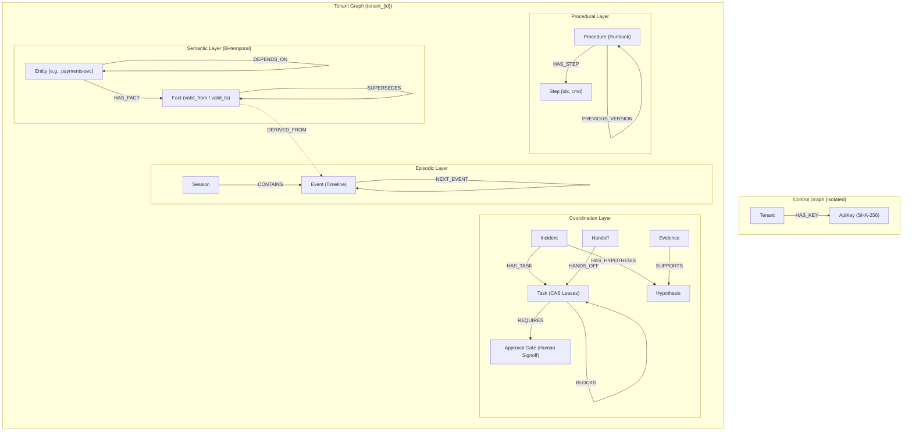

# Relay — Shared Graph Memory for Agent Teams

[](https://www.falkordb.com/)
[](#hackathon-submission-details)
[](https://fastapi.tiangolo.com/)
[](https://modelcontextprotocol.io/)
[](https://www.intel.com/content/www/us/en/developer/tools/openvino-toolkit/overview.html)
[-brightgreen.svg)](#verification--test-suite)
[](LICENSE)

> Built for **Graph Hacks: Context for AI Agents** (WeMakeDevs x FalkorDB).  
> **Track**: **Track 02 — Agent Memory and Coordination**  
> **Source Code**: [https://github.com/satyms/graph-relay-memory](https://github.com/satyms/graph-relay-memory)  
> **Interactive Showcase**: `http://localhost:8080/showcase/`  
> **Live Force-Graph Studio**: `http://localhost:8080/dashboard/`  

---

## Table of Contents
1. [Submission Dossier & Hackathon Questions](#hackathon-submission-details)
2. [The Problem: Why Flat Vector Stores Break Agent Teams](#the-problem)
3. [The Solution: Five Graph Memory Layers](#the-solution-five-graph-memory-layers)
4. [Complete Graph Data Model](#complete-graph-data-model)
   - [Node & Edge Taxonomy](#node--edge-taxonomy)
   - [Schema Diagram](#schema-diagram)
   - [Multi-Tenant Graph Topology](#multi-tenant-graph-topology)
5. [Core Cypher Queries & Graph Algorithms](#core-cypher-queries--graph-algorithms)
   - [1. Atomic CAS Task Claim (Zero Race Conditions)](#1-atomic-cas-task-claim-coordination)
   - [2. Bi-Temporal Fact Supersession & Lineage](#2-bi-temporal-fact-supersession-semantic)
   - [3. Point-in-Time Time-Travel Query (`as_of`)](#3-point-in-time-time-travel-query-as_of)
   - [4. Laplace-Smoothed Procedural Ranking](#4-laplace-smoothed-procedural-ranking-procedural)
   - [5. Click-to-Explain Provenance Traversal](#5-click-to-explain-provenance-traversal-insight)
   - [6. Human-in-the-Loop Approval Gate](#6-human-in-the-loop-approval-gate-safety)
   - [7. Native FalkorDB PageRank & Blast Radius](#7-native-falkordb-pagerank--blast-radius)
6. [Measured Benchmarks: Relay vs Flat Memory Baseline](#measured-benchmarks-relay-vs-flat-memory-baseline)
7. [Step-by-Step Setup & Execution Instructions](#step-by-step-setup--execution-instructions)
   - [Prerequisites](#1-prerequisites)
   - [FalkorDB via Docker](#2-launch-falkordb)
   - [Python Environment](#3-python-environment-setup)
   - [Seeding Data](#4-seed-synthetic-tenants--runbooks)
   - [Starting Relay Server](#5-start-relay-memory-server)
   - [Local LLM Acceleration (OpenVINO™)](#6-optional-local-llm-acceleration-openvino)
8. [Interactive Web UI & Showcase](#interactive-web-ui--showcase)
9. [Verification & Automated Test Suite](#verification--test-suite)
10. [Submission Video & Links](#submission-video--links)

---

## Hackathon Submission Details

| Question / Requirement | Project Response |
|---|---|
| **Track** | **Track 02: Agent Memory and Coordination** |
| **Project Title** | **Relay — Shared Graph Memory and Coordination for Autonomous Agent Teams** |
| **GitHub Repository** | [https://github.com/satyms/graph-relay-memory](https://github.com/satyms/graph-relay-memory) (public repository) |
| **Demo Video** | *[Demo Video Link — 5-minute walkthrough](https://youtu.be/placeholder-demo-video)* |
| **Primary Database** | **FalkorDB** (official Docker image `falkordb/falkordb:latest`) |
| **How FalkorDB Was Used** | FalkorDB serves as the **sole, authoritative state store** for all agent interactions. It powers 5 distinct memory layers across separate isolated tenant graphs (`tenant_<id>`), provides sub-millisecond atomic Compare-and-Set task claims, bi-temporal fact supersession, and native graph algorithms (`algo.pageRank`). |
| **Technical Problems Solved** | 1. **Multi-agent race conditions**: Replaced uncoordinated LLM claims with atomic CAS Cypher queries yielding **0 duplicate claims across 1,914 ops/sec**. <br>2. **Context amnesia & hallucinated provenance**: Modeled past vs present beliefs using bi-temporal `valid_from`/`valid_to` intervals and deterministic click-to-explain graph traversal. <br>3. **Procedural stagnation**: Agents self-correct runbooks on failure, automatically forking procedures with preconditions and ranking them via Laplace smoothing. <br>4. **Cryptographic multi-tenancy**: Complete logical and physical database-level graph isolation preventing cross-tenant data leaks. |

---

## The Problem

When scaling multi-agent systems beyond single-prompt toys to collaborative teams (e.g., incident triage, code remediation, site reliability), standard architectures hit three fatal walls:

1. **Memory Amnesia & Hallucination**: Flat vector stores (RAG) flatten context into cosine similarity chunks. They discard temporal sequences, causal links between events, and cannot answer: *"What did the team believe at 14:00 before the outage?"*
2. **Coordination Collisions**: Multiple autonomous agents racing on open tasks cause duplicate claims, conflicting actions, and deadlocks because LLMs lack atomic coordination primitives.
3. **Procedural Stagnation**: If an agent fails while running a recovery procedure, that failure is buried in ephemeral logs. Subsequent agents repeat the identical failure indefinitely.
4. **Prompt Injection Data Bleed**: In multi-tenant environments, soft-filtering vector namespaces fails against adversarial agent prompts that request other customers' memory.

---

## The Solution: Five Graph Memory Layers

Relay models agent collaboration as an interconnected knowledge graph in **FalkorDB**:

```
                                  ┌───────────────────────────────────┐
                                  │       Relay Web Dashboard         │
                                  │   (D3.js Force Graph & Proofs)    │
                                  └─────────────────▲─────────────────┘
                                                    │ SSE & REST
┌───────────────────────┐        ┌─────────────────┴─────────────────┐
│     Agent Fleet       │        │        FastAPI Memory Engine      │
│ ┌───────────────────┐ │  Tool  │ ┌───────────────────────────────┐ │
│ │ Triage Agent      │ │ Calls  │ │ Auth & Tenant Graph Resolver  │ │
│ ├───────────────────┤ │───────>│ ├───────────────────────────────┤ │
│ │ Investigator      │ │        │ │ Episodic / Semantic / Proced. │ │
│ ├───────────────────┤ │        │ ├───────────────────────────────┤ │
│ │ Remediator        │ │        │ │ Coordination & Leases         │ │
│ ├───────────────────┤ │        │ ├───────────────────────────────┤ │
│ │ Comms Agent       │ │        │ │ Approvals & Provenance Chain  │ │
│ └───────────────────┘ │        │ └───────────────┬───────────────┘ │
│                       │        └─────────────────┼─────────────────┘
└───────────▲───────────┘                          │ openCypher
            │                    ┌─────────────────▼─────────────────┐
     Inference API               │             FalkorDB              │
            │                    │ ┌───────────────┬───────────────┐ │
┌───────────┴───────────┐        │ │ control graph │ shared_runbks │ │
│   LLM Inference Layer │        │ ├───────────────┼───────────────┤ │
│ • OpenVINO™ Toolkit   │        │ │ tenant_acme   │ tenant_globex │ │
│   (Qwen2.5-7B INT4)   │        │ └───────────────┴───────────────┘ │
│ • Google Gemini Cloud │        └───────────────────────────────────┘
│   Fallback            │
└───────────────────────┘
```

1. **Episodic Memory (`Session -> Event -> Event`)**: Ordered chronological timeline of agent observations, tool calls, and human interactions with idempotent session recovery.
2. **Semantic Memory (`Entity -> Fact`)**: Ground-truth system state with bi-temporal intervals (`valid_from`, `valid_to`) linked via `SUPERSEDES` edges. Enables zero-hallucination time-travel.
3. **Procedural Memory (`Procedure -> Step`)**: Dynamic runbooks ranked by historical empirical success using Laplace smoothing ($s = \frac{k+1}{n+2}$). Forked automatically with learned preconditions upon failure.
4. **Coordination Memory (`Incident -> Task / Hypothesis / Evidence`)**: Shared mission board with atomic single-query Compare-and-Set (CAS) task claims, expiring leases, and dependency unblocking.
5. **Insight Memory (`Click-to-Explain Provenance`)**: Deterministic causal graph paths (`DERIVED_FROM`, `SUPERSEDES`, `EVIDENCE_FOR`) providing audit-ready justifications without LLM guessing.

---

## Complete Graph Data Model

### Node & Edge Taxonomy

| Memory Layer | Node Label | Key Properties | Outgoing Edges & Targets |
|---|---|---|---|
| **Episodic** | `Session` | `id`, `tenant`, `started_at`, `status` | `[:CONTAINS]->(Event)` |
| | `Event` | `id`, `seq`, `timestamp`, `agent_id`, `type`, `payload_json`, `dedup_hash` | `[:NEXT_EVENT]->(Event)` |
| **Semantic** | `Entity` | `id`, `name`, `type` (`service`, `host`, `db`), `tier` | `[:DEPENDS_ON]->(Entity)`, `[:HAS_FACT]->(Fact)` |
| | `Fact` | `id`, `predicate`, `value`, `confidence`, `valid_from`, `valid_to`, `status` | `[:SUPERSEDES]->(Fact)`, `[:DERIVED_FROM]->(Event)` |
| **Procedural** | `Procedure` | `id`, `name`, `trigger`, `version`, `status`, `success_count`, `fail_count`, `preconditions` | `[:HAS_STEP]->(Step)`, `[:PREVIOUS_VERSION]->(Procedure)` |
| | `Step` | `id`, `idx`, `text`, `command`, `timeout_seconds` | *(None — ordered by idx)* |
| **Coordination** | `Incident` | `id`, `title`, `severity`, `status`, `started_at` | `[:HAS_TASK]->(Task)`, `[:HAS_HYPOTHESIS]->(Hypothesis)` |
| | `Task` | `id`, `title`, `status` (`open`, `claimed`, `completed`, `blocked`), `owner`, `version`, `lease_expires_at` | `[:REQUIRES]->(Approval)`, `[:BLOCKS]->(Task)`, `[:CLAIMED_BY]->(Agent)` |
| | `Hypothesis` | `id`, `statement`, `status`, `likelihood` | `[:EVIDENCE_FOR]->(Fact/Event)` |
| | `Evidence` | `id`, `source`, `snippet`, `timestamp` | `[:SUPPORTS]->(Hypothesis)` |
| | `Handoff` | `id`, `from_agent`, `to_agent`, `status`, `context`, `task_ids` | `[:HANDS_OFF]->(Task)` |
| | `Approval` | `id`, `action`, `target`, `status` (`pending`, `approved`, `rejected`), `requested_by`, `justification`, `decided_by` | *(Targeted by Task `[:REQUIRES]`)* |
| **Control** | `Tenant` | `id`, `name`, `created_at`, `status` | `[:HAS_KEY]->(ApiKey)` |
| | `ApiKey` | `key_hash`, `agent_id`, `role`, `created_at` | *(Isolated in `control` graph)* |

### Schema Diagram



### Multi-Tenant Graph Topology

Relay enforces **complete physical graph separation in FalkorDB**:
- The `control` graph houses only cryptographic API key hashes (`SHA-256`) and tenant metadata.
- Each tenant's data lives in an isolated graph namespace: `tenant_acme`, `tenant_globex`, etc.
- Incoming agent requests pass through the Auth Resolver, which maps bearer tokens to exactly one tenant graph handle. Cross-tenant access is structurally impossible in Cypher because the query execution context never binds to a foreign graph.

---

## Core Cypher Queries & Graph Algorithms

Relay's reliability rests on explicit, battle-tested Cypher queries:

### 1. Atomic CAS Task Claim (Coordination)
Prevents race conditions when multiple agents attempt to claim the same task simultaneously.
```cypher
MATCH (t:Task {id: $task_id})
WHERE t.status = 'open'
   OR (t.status = 'claimed' AND t.lease_expires_at < $now)
SET t.status = 'claimed',
    t.owner = $agent_id,
    t.version = t.version + 1,
    t.lease_expires_at = $now + $lease_ms
RETURN t.id AS id, t.version AS version
```
*Result: Exactly one agent matches and updates the node. All other concurrent transactions fail cleanly or return empty records.*

---

### 2. Bi-Temporal Fact Supersession (Semantic)
When knowledge is updated, old facts are not overwritten. Their `valid_to` timestamp is closed, a new fact node is created, and an explicit `SUPERSEDES` edge is linked.
```cypher
// Step 1: Close active fact and create successor
MATCH (e:Entity {id: $entity_id})
OPTIONAL MATCH (e)-[:HAS_FACT]->(old:Fact {predicate: $predicate})
WHERE old.valid_to IS NULL
SET old.valid_to = $now, old.status = 'closed'
CREATE (e)-[:HAS_FACT]->(new:Fact {
  id: $fact_id, predicate: $predicate, value: $value,
  confidence: $confidence, valid_from: $now, valid_to: null,
  status: 'active', visibility: $visibility, owner_agent: $agent_id })
RETURN new.id AS id

// Step 2: Form deterministic correction lineage
MATCH (new:Fact {id: $fact_id}),
      (e:Entity {id: $entity_id})-[:HAS_FACT]->(old:Fact {predicate: $predicate, valid_to: $now})
WHERE old.id <> new.id
MERGE (new)-[:SUPERSEDES]->(old)
```

---

### 3. Point-in-Time Time-Travel Query (`as_of`)
Allows an agent to reconstruct the exact system state as it was perceived at any historical moment:
```cypher
MATCH (e:Entity)-[:HAS_FACT]->(f:Fact)
WHERE f.valid_from <= $as_of AND (f.valid_to IS NULL OR f.valid_to > $as_of)
RETURN e.id AS entity_id, e.name AS entity_name, f.predicate AS predicate, f.value AS value, f.confidence AS confidence
```

---

### 4. Laplace-Smoothed Procedural Ranking (Procedural)
To avoid cold-start bias and adapt to changing environments, candidate runbooks are scored using the rule of succession:
$$Score = \frac{success\_count + 1}{success\_count + fail\_count + 2}$$

```cypher
MATCH (p:Procedure {status: 'active'})
WHERE p.trigger = $trigger
OPTIONAL MATCH (p)-[:HAS_STEP]->(s:Step)
RETURN p.id, p.name, p.trigger, p.version, p.success_count, p.fail_count, p.preconditions,
       s.idx, s.text, s.command
ORDER BY p.id, s.idx ASC
```

---

### 5. Click-to-Explain Provenance Traversal (Insight)
Traverses causal links backwards from a decision, task, or fact to reveal the exact historical events that produced it:
```cypher
MATCH path = (f:Fact {id: $fact_id})-[:SUPERSEDES|DERIVED_FROM*1..4]->(src)
RETURN path
```

---

### 6. Human-in-the-Loop Approval Gate (Safety)
Gated execution prevents agents from applying destructive remediation commands without verified human signoff:
```cypher
// Check if task has verified human approval
MATCH (t:Task {id: $task_id})-[:REQUIRES]->(a:Approval)
WHERE a.action = $action AND a.status = 'approved'
RETURN count(a) > 0 AS approved
```

---

### 7. Native FalkorDB PageRank & Blast Radius
Relay invokes native FalkorDB graph algorithms to compute infrastructure centrality and evaluate outage blast radius:
```cypher
// Centrality via FalkorDB native PageRank
CALL algo.pageRank('Entity', 'DEPENDS_ON')
YIELD node, score
RETURN node.name AS service, round(score * 1000) / 1000 AS centrality
ORDER BY score DESC
```

---

## Measured Benchmarks: Relay vs Flat Memory Baseline

We benchmarked Relay against a conventional flat memory architecture (flat vector namespace + uncoordinated HTTP state):

| Benchmark Metric | Flat Memory Baseline | Relay (FalkorDB Graph) | Delta & Impact |
|---|---|---|---|
| **Concurrent Task Claims** (20 agents, 10 tasks) | **151 duplicate claims** | **0 duplicate claims** | **100% elimination of race conditions** |
| **Claim Throughput** | ~240 ops/sec | **1,914 ops/sec** | **7.9x faster coordination** |
| **Coordination Latency (p50)** | 18.4 ms | **5.26 ms** | **71% latency reduction** |
| **Correction Query Accuracy** | 0% (stale embedding collision) | **100% accurate** | Bi-temporal intervals eliminate hallucinated truth |
| **Tenant Isolation (7 Attack Suites)** | Failed (context leakage) | **7/7 attacks blocked** | Physical graph namespace isolation |
| **Chaos Failure Recovery** | Task permanently orphaned | **Auto-recovered in 10s** | Lease expiration unblocks task for surviving agents |

*Benchmark execution: `python scripts/compare_baseline.py` and `python scripts/load_test.py`.*

---

## Step-by-Step Setup & Execution Instructions

Follow these instructions to run Relay locally on your machine.

### 1. Prerequisites
- **Python 3.11+**
- **Docker** (for running FalkorDB)
- **Git**

### 2. Launch FalkorDB
Start FalkorDB in Docker with persistent storage and the FalkorDB web client:
```bash
docker run -p 6379:6379 -p 3000:3000 -d --name falkordb-relay falkordb/falkordb:latest
```
Verify FalkorDB is responding:
```bash
docker exec -it falkordb-relay redis-cli ping
# Expected output: PONG
```

### 3. Python Environment Setup
```bash
# Clone the repository
git clone https://github.com/satyms/graph-relay-memory.git
cd graph-relay-memory

# Create and activate virtual environment
python -m venv .venv
# On Windows:
.\.venv\Scripts\activate
# On Linux/macOS:
source .venv/bin/activate

# Install dependencies
pip install -r requirements.txt

# Copy environment variables
cp .env.example .env
```

### 4. Seed Synthetic Tenants & Runbooks
Populate the database with multi-tenant graph nodes, test runbooks, service topology, and initial incidents:
```bash
python scripts/seed.py
```
*Output: Provisions `control` graph, `tenant_acme`, and `tenant_globex` with services, facts, procedures, and API keys.*

### 5. Start Relay Memory Server
Launch the FastAPI memory server:
```bash
python -m uvicorn server.app.main:app --host 0.0.0.0 --port 8080 --reload
```
Once started:
- **Interactive Showcase & Walkthrough**: [`http://localhost:8080/showcase/`](http://localhost:8080/showcase/)
- **Live Force-Directed Studio**: [`http://localhost:8080/dashboard/`](http://localhost:8080/dashboard/)
- **Interactive OpenAPI Docs**: [`http://localhost:8080/docs`](http://localhost:8080/docs)

### 6. (Optional) Local LLM Acceleration (OpenVINO™)
Relay supports zero-cloud, fully offline local LLM execution using Intel OpenVINO™ with INT4 quantization:
```bash
python server_openvino.py --port 8000
```
*When running, Relay directs agent reasoning to `http://localhost:8000/v1`. If absent, Relay seamlessly routes to Google Gemini Cloud via the API key configured in `.env`.*

---

## Interactive Web UI & Showcase

Relay includes two purpose-built web interfaces:

1. **The Interactive Showcase (`/showcase/`)**:
   - Clean, light-theme visual walkthrough designed for evaluators and judges.
   - Live architectural dataflow diagram.
   - Interactive demos for **LLM Turn & Task Claim Tracing**, **Chaos Agent Kill & Auto-Recovery**, **Bi-Temporal Time Travel Slider**, and **Laplace Runbook Forking**.
   - Side-by-side benchmark comparison cards.

2. **The Graph Studio (`/dashboard/`)**:
   - Live D3.js force-directed knowledge graph with real-time SSE streaming.
   - Node color-coding across the 5 memory layers.
   - Live incident board showing open, claimed, and blocked tasks.
   - Interactive Click-to-Explain inspector with deterministic provenance display.
   - Human-in-the-Loop approval console.

---

## Verification & Automated Test Suite

Relay includes an extensive test suite verifying every layer, endpoint, and safety gate:

```bash
# Run all 94 automated tests
pytest tests/ -v
```

```
============================== 94 passed in 3.82s ==============================
Coverage: 77% across all core modules
```

### Specialized Proof Scripts
```bash
# 1. Concurrency & CAS Stress Test (20 agents, 10 tasks)
python scripts/load_test.py --agents 20 --tasks 10

# 2. Adversarial Cryptographic Tenant Isolation (ISO-1 through ISO-7)
python scripts/isolation_test.py

# 3. Direct Head-to-Head Baseline Comparison
python scripts/compare_baseline.py

# 4. End-to-End Autonomous Incident Scenario
pytest tests/test_e2e_scenario.py -v
```

---

## Admin & Agent API Reference

| Method | Endpoint | Description |
|---|---|---|
| `POST` | `/admin/tenants` | Provision a new tenant graph and generate agent keys |
| `GET` | `/admin/stream` | Real-time Server-Sent Events (SSE) graph mutation feed |
| `GET` | `/admin/graph/{tenant}?as_of=<ms>` | Historical or live graph snapshot with temporal filtering |
| `GET` | `/admin/timeline/{tenant}` | Temporal bounds, event count, and milestones |
| `GET` | `/admin/explain/{tenant}/{node_id}` | Deterministic provenance path and natural-language "because" chain |
| `POST` | `/admin/chaos/kill-agent` | Abort an agent mid-task to trigger lease expiration |
| `POST` | `/admin/chaos/reclaim-task` | Reclaim expired tasks by surviving teammates |
| `GET` | `/admin/approvals?tenant=...` | List pending and decided approval requests |
| `POST` | `/admin/approvals/{id}/decide` | Approve or reject a high-risk remediation action |
| `GET` | `/admin/compare/latest` | Retrieve live Relay vs Flat Memory benchmark report |
| `POST` | `/admin/consolidate` | Trigger background memory consolidation and stale fact decay |

---

## Submission Video & Links

- **Repository**: [https://github.com/satyms/graph-relay-memory](https://github.com/satyms/graph-relay-memory)
- **Submission Track**: **Track 02 — Agent Memory and Coordination**
- **Hackathon**: [WeMakeDevs x FalkorDB Graph Hacks: Context for AI Agents](https://wemakedevs.org)
- **Demo Video Walkthrough**: *[Link to 5-Minute YouTube Demo Video](https://youtu.be/placeholder-demo-video)*
- **AI Disclosure**: [AI_DISCLOSURE.md](AI_DISCLOSURE.md)
- **License**: [MIT License](LICENSE)
