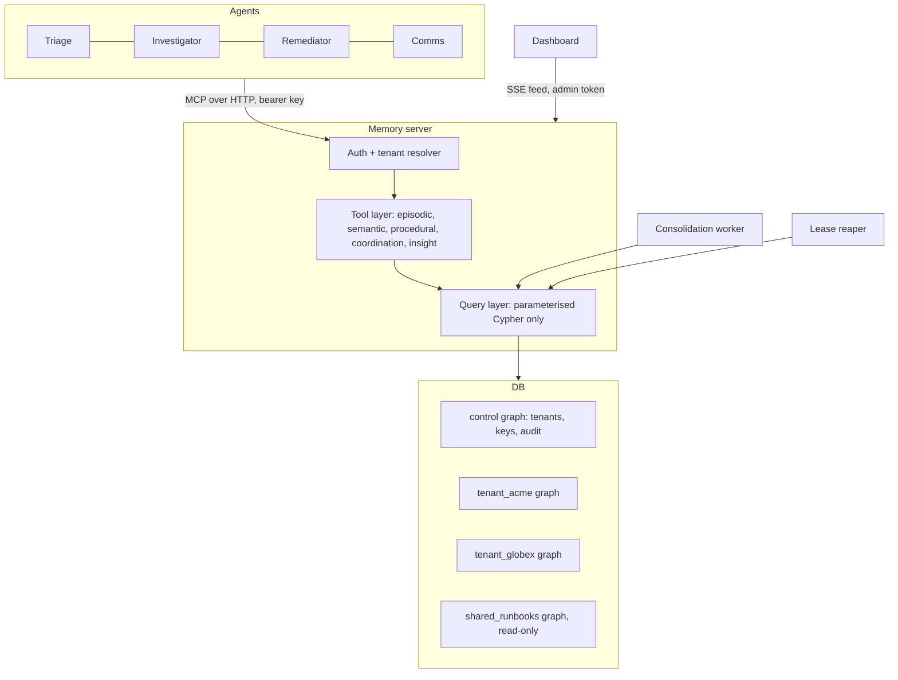

# Architecture

## 1. Design principles

1. **The graph is the product.** Memory, claims, handoffs and procedures are nodes and edges. If FalkorDB is removed, Relay stops working (hackathon rule: the graph must do real work).
2. **Agents never touch the database.** Every read and write goes through one MCP memory server with typed tools. There is no raw-Cypher tool.
3. **Tenancy is enforced by the server, not by agents.** The tenant is derived from the API key. No tool accepts a `tenant_id` argument.
4. **Writes that can race are single atomic queries.** Claims and fact supersession use compare-and-set inside one Cypher statement.
5. **History is never destroyed.** Corrections close a fact's validity window and link a new one. Nothing is overwritten.

## 2. Component map

## 3. Components

| Component | Responsibility | Notes |
|---|---|---|
| Agents | One LLM loop per role, each with a role-specific system prompt and the same MCP toolset | Python + Anthropic SDK + MCP client |
| Auth and tenant resolver | Map bearer key to `(tenant_id, agent_id, role)`; select the tenant's graph | Keys stored hashed in the `control` graph |
| Tool layer | Validate input, apply idempotency, call named queries, shape responses | One module per memory type |
| Query layer | Parameterised Cypher only; read tools use read-only queries | No string-built Cypher |
| FalkorDB | One graph per tenant, plus `control` and `shared_runbooks` | Client: official `falkordb` Python package |
| Consolidation worker | Turn recent episodes into facts, merge duplicates, decay stale memory | Triggerable on demand for demos |
| Lease reaper | Re-open tasks whose lease expired | Runs every few seconds |
| Dashboard | Live force-directed graph, handoff timeline, load test and isolation panels | Fed by SSE from the server |

## 4. Tool call lifecycle

1. Agent sends an MCP tool call with `Authorization: Bearer <key>`.
2. Server hashes the key, looks up `(tenant, agent, role)` in `control`. Unknown key means `FORBIDDEN`.
3. Server selects graph `tenant_<id>`. This name comes from the lookup, never from the request body.
4. For writes, the `idempotency_key` is checked. A replay returns the original result.
5. Tool runs one named query (or a short fixed sequence) with parameters.
6. Result is shaped, an audit entry is written to `control`, and a change event is pushed to the SSE feed.

## 5. Tenancy and visibility

- **Hard isolation:** each tenant has its own graph. A query run against `tenant_acme` cannot see `tenant_globex` nodes because they are in a different graph.
- **Shared knowledge:** `shared_runbooks` holds starter procedures. It is only reachable through `find_procedure`, which reads it with a read-only query and never writes.
- **Visibility inside a tenant (stretch):** `Fact` and `Procedure` carry `visibility` = `private | team`. `private` is readable only by the owning agent.

## 6. Concurrency model

- FalkorDB processes writes to a single graph one at a time, so one Cypher statement is atomic. This is what makes compare-and-set safe. Verify this behaviour in the FalkorDB docs and confirm with `tests/test_concurrency.py`.
- **Claim:** one `MATCH ... WHERE status = 'open' ... SET status = 'claimed', version = version + 1` statement. Zero rows returned means the agent lost the race.
- **Lease:** a claim carries `lease_expires_at`. The owner renews while working. The reaper re-opens expired tasks.
- **Idempotency:** every write tool takes an `idempotency_key`. Events use `MERGE` on that key.
- **Connection pooling:** server keeps a pool of FalkorDB connections and runs tool handlers concurrently.
- **Reads** use the read-only query path and do not block on writes to other graphs.

## 7. Memory lifecycle

| Stage | What happens |
|---|---|
| Write | `log_event` appends to the session timeline. Agents choose the right tool by lifetime: event (this session), fact (durable knowledge), procedure outcome (what worked) |
| Consolidate | Worker reads recent events, asks the LLM for candidate facts, writes them via `upsert_fact` with `DERIVED_FROM` links to the events |
| Supersede | A correction sets `valid_to` on the old fact, creates the new fact, adds `SUPERSEDES` |
| Decay | Low-confidence facts untouched for a configured period get `status = 'stale'` and drop out of default retrieval |
| Forget | `forget_fact` soft-closes a fact with a reason. Hard deletion is admin-only |
| Learn | `record_outcome(success=false)` increments `fail_count`, stores `violated_assumption`, and creates a new procedure version with an added precondition |

## 8. Retrieval strategy

1. **Graph first.** Traverse from entities mentioned in the current situation to their current facts, linked procedures and open tasks.
2. **Keyword second.** Use a FalkorDB full-text index on `Event.summary`, `Fact.value` and `Procedure.trigger` for fuzzy matches.
3. **Rank procedures** by smoothed success rate: `(success + 1) / (success + fail + 2)`.
4. **Budget the output.** Every recall tool takes a `limit` and the server caps total characters returned so memory cannot flood an agent's context.
5. **Vector search is optional.** Add FalkorDB vector indexes only if time allows.

## 9. Graph algorithms in use

The service-dependency subgraph (`Entity -[:DEPENDS_ON]-> Entity`) feeds the insight tools:

| Tool | Algorithm |
|---|---|
| `blast_radius` | Breadth-first traversal over `DEPENDS_ON`, reversed |
| `rank_critical_services` | PageRank |
| `explain` | Shortest path from a conclusion back to its source events |

Check exact procedure names and signatures in the FalkorDB algorithms docs before coding.

## 10. Failure modes and responses

| Failure | Response |
|---|---|
| Agent dies mid-task | Lease expires, reaper re-opens the task, next agent claims it |
| Two agents claim at once | One gets the row, the other gets `CONFLICT` and picks another task |
| Duplicate tool call after timeout | Idempotency key returns the original result |
| Bad or missing key | `FORBIDDEN`, audit entry written |
| FalkorDB unavailable | Tool returns `UNAVAILABLE` with retry hint, agents back off |
| Contradictory facts | Newest valid fact wins by default, history remains queryable via `as_of` |

## 11. Technology choices

| Layer | Choice | Reason |
|---|---|---|
| Graph DB | FalkorDB (required) | Multi-graph tenancy, Cypher, built-in algorithms |
| Server | Python, FastAPI, MCP Python SDK | Fast to build, async, official FalkorDB client |
| Agents | Anthropic SDK with MCP tool use | Tool selection is visible in traces |
| Dashboard | React + a force-graph library | Live graph with SSE |
| Tests | pytest, asyncio, a load-test script | Proofs for concurrency and isolation |

Swap the server or dashboard language if your team prefers, but keep the rules in section 1.

## 12. Non-goals

- No production auth (API keys are enough for the demo)
- No raw-Cypher or free-form query tool
- No real user data
- No multi-region or horizontal FalkorDB scaling
